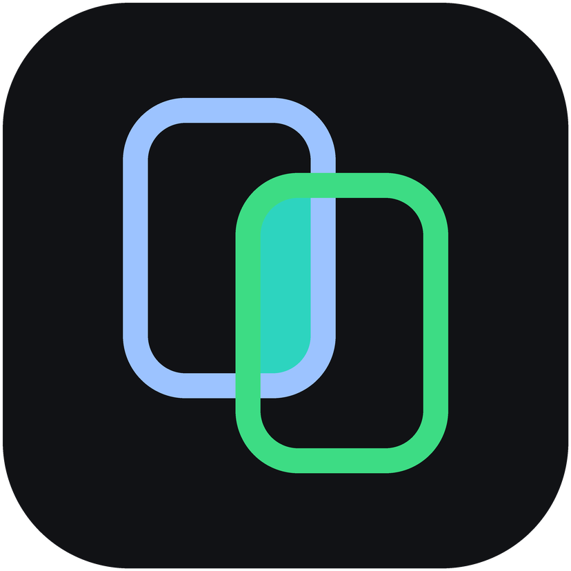
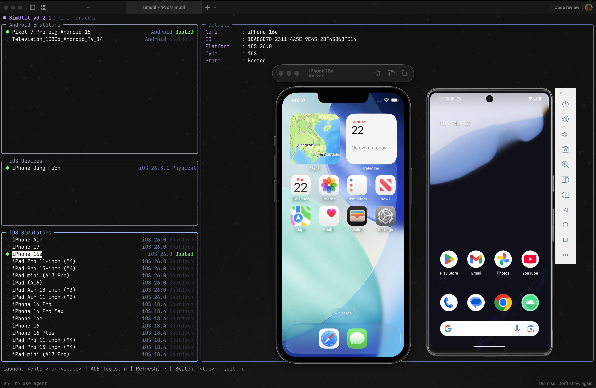

<p align="center">
  
</p>
<h1 align="center">SimUtil</h1>

<p align="center">
  <strong>Everyday utilities for Android emulators, iOS simulators and real devices</strong><br>
  Launch, stream, control, record, test and clean up, from one desktop app or the command line.
</p>

<p align="center">
  <a href="https://www.producthunt.com/products/simutil?embed=true&amp;utm_source=badge-featured&amp;utm_medium=badge&amp;utm_campaign=badge-simutil" target="_blank" rel="noopener noreferrer"></a>
</p>
<p align="center">
  
  <a href="https://github.com/dungngminh/simutil/actions/workflows/ci.yaml"></a>
  <a href="https://github.com/dungngminh/simutil/releases?q=app-v"></a>
  <a href="https://github.com/dungngminh/simutil/releases?q=cli-v"></a>
</p>

Mobile development means juggling Android Studio, Xcode, `adb`, `simctl`,
scrcpy and a pile of scripts just to get a device up and look at it.
SimUtil puts those chores in one place, without opening an IDE:

- **SimUtil Desktop** — stream and control many devices side by side
  (emulators, simulators, real Android phones and real iPhones / iPads), record
  them, run scenarios across them, and let AI agents drive them over MCP.
- **`simutil` CLI** — list, launch and shut down devices, connect over Wi-Fi,
  read Logcat and run your own tools from scripts or the terminal.
- **Dart packages** — the same device services (`adb`, `simctl`, `devicectl`)
  as libraries for your own tooling.

Runs on macOS, Linux and Windows. iOS features need macOS (Xcode).

<p align="center">
  
</p>

https://github.com/user-attachments/assets/b0463741-6d31-496d-99a8-264a5e69457a

<p align="center">
  
</p>

<p align="center">
  
</p>

## Utilities

| | Utility | Desktop | CLI |
| --- | --- | :---: | :---: |
| **Devices** | Start / stop emulators and simulators, headless or with their window | ✓ | ✓ |
| | Android launch options: cold boot, no audio | ✓ | ✓ |
| | Wipe data or delete an emulator / simulator | ✓ | |
| | Slim iOS simulators (about 1 GB of memory instead of 4 GB) | ✓ | |
| **Stream & control** | Many devices side by side, grid or spotlight layout | ✓ | |
| | Real Android phones over USB or Wi-Fi | ✓ | |
| | Touch, swipe, navigation buttons and keyboard typing on every stream | ✓ | |
| | Real iPhones / iPads connected by USB: device frame, screenshots, recording with sound (view only, macOS) | ✓ | |
| | Built-in scrcpy server, no separate install | ✓ | |
| **Connect** | Wireless ADB by QR code, pairing code or IP | ✓ | ✓ |
| **Capture** | Screenshot one device or the whole grid | ✓ | |
| | Record one device or the whole grid (native 60 fps on macOS) | ✓ | |
| **Apps** | Install by dropping an `.apk` / `.app` / `.ipa` on a device | ✓ | |
| | Convert an iPhone build so it runs on a simulator (Apple Silicon) | ✓ | |
| **Test & automate** | Scenario studio: YAML steps (tap by label, swipe, type, assert) on many devices at once | ✓ | |
| | MCP server for Claude Code, Codex, Cursor, Gemini CLI, VS Code | ✓ | |
| | JSON output and a full command schema for scripts and agents | | ✓ |
| **Debug** | Logcat with filtering | | ✓ |
| | Custom tools (scrcpy, Maestro, scripts) as YAML plugins | | ✓ |
| **Clean up** | Clear Xcode DerivedData after a size preview (macOS) | ✓ | ✓ |

## Install

### SimUtil Desktop

Installers are on the [releases page](https://github.com/dungngminh/simutil/releases?q=app-v)
(`app-v*` tags). The app updates itself in place from where you installed it.

**macOS** (Monterey or later; pulls in `adb` and `ffmpeg`):

```bash
brew update
brew tap dungngminh/simutil
brew install --cask simutil-desktop
```

Or download `SimUtil-macos.dmg` and drag SimUtil into Applications.

**Windows**: run `SimUtil-windows-x64-setup.exe` from the
[latest desktop release](https://github.com/dungngminh/simutil/releases?q=app-v).
The installer offers to install Android platform-tools and FFmpeg.

**Linux** (x86_64 AppImage; installs `adb`, `ffmpeg` and FUSE, re-run to update):

```bash
curl -fsSL https://raw.githubusercontent.com/dungngminh/simutil/main/app/packaging/linux/install.sh | bash
```

More, including the MCP tool list: [app/README.md](app/README.md).

### `simutil` CLI

```bash
# macOS / Linux
curl -fsSL https://raw.githubusercontent.com/dungngminh/simutil/main/install.sh | bash

# Homebrew
brew tap dungngminh/simutil && brew install simutil

# pub.dev
dart pub global activate simutil
```

Windows (PowerShell):

```powershell
powershell -ExecutionPolicy Bypass -Command "iwr -useb https://raw.githubusercontent.com/dungngminh/simutil/main/install.ps1 | iex"
```

`simutil upgrade` updates it the same way you installed it. simutil checks for
a new release at most once a day; set `SIMUTIL_NO_UPDATE_CHECK=1` to turn that off.

## CLI usage

```bash
simutil list -v                    # devices on every platform, grouped
simutil list --json                # for scripts and agents
simutil launch <device-id>         # boot (alias: start)
simutil launch <id> -c --no-audio  # cold boot, no audio (Android)
simutil launch <id> --headless     # no emulator window / Simulator app
simutil shutdown <device-id>       # alias: stop
simutil wipe <device-id>           # erase data of a shut-down device (asks y/N)
simutil delete <device-id> -y      # delete it; -y skips the prompt
simutil android device list -r     # running adb devices only
simutil plugin run scrcpy mirror -d emulator-5554
simutil schema                     # every command as JSON, for agents
```

Run `simutil` with no arguments for an interactive device picker with ADB
tools, Logcat and plugins. `simutil <command> --help` lists each command's flags.

### Plugins

Wire external tools (scrcpy, Maestro, your own scripts) to a device in
`~/.simutil/settings.yaml`, no code changes needed:

```yaml
plugins:
  - id: scrcpy
    label: scrcpy
    availability:
      command: scrcpy
      args: [--version]
    commands:
      - id: mirror
        label: Screen Mirror
        command: scrcpy
        args: [-s, "{device.id}"]
        platforms: [android]
        requires_running: true
```

Full reference: [docs/plugins.md](docs/plugins.md).

## Supported platforms

| Host OS | Android emulators & devices | iOS simulators & devices |
| ------- | --------------------------- | ------------------------ |
| macOS   | Yes                         | Yes (requires Xcode)     |
| Linux   | Yes                         | No                       |
| Windows | Yes                         | No                       |

iOS support uses Apple's tools (`xcrun simctl`, `xcrun devicectl`), which only
exist on macOS. On Xcode 27+, a simulator opens in DeviceHub.app; earlier
versions use Simulator.app.

## Packages

Monorepo (pub workspace); each package is versioned and published separately:

| Package | Contents |
| ------- | -------- |
| [`app`](app) | SimUtil Desktop: multi-device streaming, recording, scenarios, MCP server |
| [`simutil`](packages/simutil) | The `simutil` CLI |
| [`simutil_core`](packages/simutil_core) | Models, `CommandExec`, `DeviceService` |
| [`simutil_adb`](packages/simutil_adb) | Android: devices, wireless ADB, scrcpy session, Logcat |
| [`simutil_apple`](packages/simutil_apple) | Apple: simulators, physical devices, Xcode cache |
| [`simutil_plugins`](packages/simutil_plugins) | YAML plugin catalog and runner |
| [`simutil_shared`](packages/simutil_shared) | Shared app layer: settings, app state, changelog |
| [`simutil_h264`](packages/simutil_h264) | Native H.264 decoding into Flutter textures |

## Contributing

```bash
git clone https://github.com/dungngminh/simutil.git
cd simutil
flutter pub get              # whole workspace, desktop app included
dart run melos run check     # analyze + Dart and Flutter tests
cd app && flutter run -d macos
```

Fork, branch, open a Pull Request. Architecture notes: [docs/ai/architecture.md](docs/ai/architecture.md).

## License

MIT — see [LICENSE](LICENSE)
