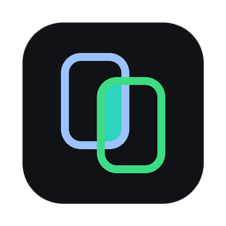

<p align="center">
  
</p>

# SimUtil desktop

Flutter desktop app (macOS, Windows, Linux): a tray menu that lists and
starts devices, and a window that streams and controls many Android
emulators/devices and iOS simulators side by side.

- Start devices headless (no emulator window / Simulator app) and stream
  them into the grid; stop them; slim iOS simulators to save memory.
- Touch, swipe and navigation buttons on every stream; Apple device frames
  for simulators (from your Xcode), drawn frames otherwise.
- Grid or spotlight layouts (one stream large, the rest in a strip).
- Record one device or the whole grid to `~/Movies/SimUtil`
  (`~/Videos/SimUtil` on Windows/Linux).
- Right-click a device for per-device settings (headless, cold boot,
  stream resolution / frame rate / bit rate).
- Clear Xcode DerivedData (macOS) from the top bar or the tray menu, after a
  confirmation.
- MCP server for agents, see below.

## MCP server

SimUtil serves [MCP](https://modelcontextprotocol.io) over HTTP at
`http://127.0.0.1:8765/mcp` (loopback only; set `SIMUTIL_MCP_PORT` to change
the port). Click the plug icon in the top-right corner for a copy-ready setup
for Claude Code, Codex, Cursor, Gemini CLI and VS Code; the tray menu copies
the URL. For example:

```bash
claude mcp add --transport http simutil http://127.0.0.1:8765/mcp
```

| Tool | What it does |
| ---- | ------------ |
| `list_devices` | Devices with state, slim mode, streaming (with `fps` shown), and `recording_seconds` while recording |
| `get_spotlight` | Stream layout, the device shown large, how long it and the grid have been recording |
| `start_device` / `shutdown_device` | Boot (headless by default) or shut down an emulator / simulator |
| `stream_device` | Show a running device in the grid |
| `tap` / `swipe` / `press_button` | Input with coordinates normalized to 0..1; back (Android), home, recents, lock |
| `run_scenario` | The same steps (`tap`, `swipe`, `press`, `wait`) on several Android and iOS devices in parallel, all starting together; reports each device's outcome and timing |
| `screenshot` | PNG of a running device |
| `record_device` / `record_grid` | Start / stop a recording; returns the file when stopping |
| `set_slim` | iOS simulator: turn background services off / on (reboots a running one) |

A scenario on every streamed device:

```json
{
  "steps": [
    { "action": "press", "button": "home" },
    { "action": "swipe", "x1": 0.8, "y1": 0.5, "x2": 0.2, "y2": 0.5 },
    { "action": "wait", "ms": 800 },
    { "action": "tap", "x": 0.5, "y": 0.4 }
  ]
}
```

Pass `devices` (ids or names) to pick devices; every step is checked before
any device moves. iOS simulators that are not slim yet are switched to Slim
first (rebooted in parallel, which closes open apps); pass `"slim": false` to
skip that. Every device is readied before any starts, so they begin together;
the result has `prep_ms` (slimming and readying) and, per device, `start_ms` / `end_ms` from that
common start and `steps_ms`.

## Install

One command installs the app and the tools it drives: `adb` (Android
platform-tools) and `ffmpeg` (recordings). The scrcpy server ships inside the
app, so scrcpy itself is optional.

```bash
brew install --cask dungngminh/simutil/simutil-desktop   # macOS
```

```bash
winget install me.dungngminh.simutil                     # Windows
```

```bash
curl -fsSL https://raw.githubusercontent.com/dungngminh/simutil/main/app/packaging/linux/install.sh | bash   # Linux
```

Installers are also attached to the `app-v*` releases on
[GitHub Releases](https://github.com/dungngminh/simutil/releases):

- macOS: `SimUtil-macos.dmg` (Apple Silicon + Intel), drag SimUtil onto
  Applications. Unsigned builds: run `xattr -dr com.apple.quarantine
  /Applications/SimUtil.app` once if macOS says the app is damaged.
- Windows: `SimUtil-windows-x64-setup.exe`, a per-user install (no admin);
  it offers to install adb and FFmpeg with winget.
- Linux: `SimUtil-linux-x86_64.AppImage`; `chmod +x` and run it. Needs
  `libfuse2` (or pass `--appimage-extract-and-run`). Packaged as an AppImage
  rather than Flatpak / Snap because their sandboxes block the host `adb`
  and USB access the app relies on.

Not installed for you: Android Studio / the SDK emulator (only needed to run
Android emulators) and Xcode (iOS simulators, macOS only).

## Requirements

- Android streaming: `adb`. The app ships the
  [scrcpy](https://github.com/Genymobile/scrcpy) 4.0 server (Apache-2.0); an
  installed scrcpy 3+ or `SCRCPY_SERVER_PATH` takes precedence.
- iOS streaming: macOS with Xcode. On Xcode 27, Device Hub may take over input;
  the tile offers a repair (restarts the simulator's apps).
- Recording: `ffmpeg` (`.mp4` output for Android, and grid recording on
  Windows / Linux). On macOS grid recording is native (macOS 12.3+) and asks
  for the Screen Recording permission on first use.
- Linux build: `libgtk-3-dev libx11-dev libxi-dev libayatana-appindicator3-dev
  libavcodec-dev libswscale-dev`.

## Run

The app is a member of the repository's pub workspace, so resolve from the
repository root (needs the Flutter SDK):

```bash
flutter pub get
cd app
flutter run -d macos   # or windows / linux
```

Tests: `flutter test` here, or `dart run melos run test:flutter` from the root.

## Benchmark

`benchmark/bench.dart` measures the running app through its MCP server:
CPU and memory of the app and its child processes, stream FPS, recording
frame rate, MCP latency and `run_scenario` skew / overhead. Build and start a
release app, boot the devices, then for example:

```bash
cd app
dart run benchmark/bench.dart stream --devices "iPhone 17e,Pixel_7" --animate
dart run benchmark/bench.dart scenario --devices "iPhone 17e,Pixel_7" --runs 20
dart run benchmark/bench.dart record --quality high --animate --devices "iPhone 17e"
```

Each run prints and saves a JSON report under `benchmark/results/`
(ignored by git). The file header lists every case and option.
